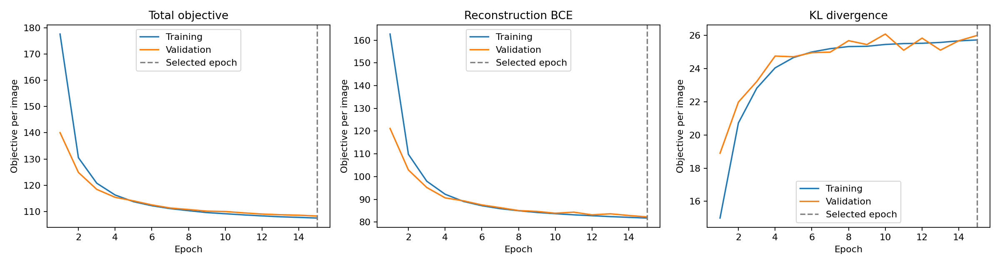
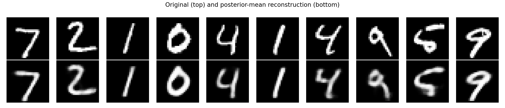
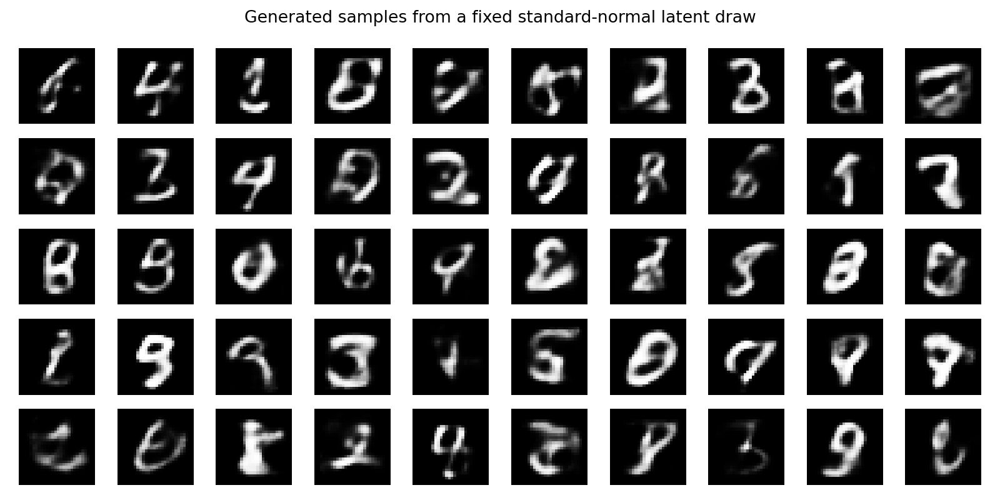

# Variational Autoencoder on MNIST

A fully connected PyTorch variational autoencoder for reconstructing handwritten digits and generating images from a standard-normal latent prior. This educational portfolio refresh builds on earlier Machine Learning for Bioinformatics coursework and uses an AI-assisted starter workflow.

## Objective

Learn a 25-dimensional latent representation of 28 x 28 grayscale images and examine reconstruction and generation through held-out objectives, fixed visual examples and recorded experiment settings. Digit labels are not used in the training loss; this is not a classifier or biomedical application.

## Data and architecture

- Dataset: MNIST, loaded with `torchvision.datasets.MNIST`.
- Reference: LeCun, Cortes and Burges, [The MNIST database of handwritten digits](https://yann.lecun.com/exdb/mnist/).
- Official training partition split into 54,000 training and 6,000 validation images; all 10,000 official test images reserved for final evaluation.
- Pixel intensities scaled to [0, 1]. Raw images are not redistributed.
- Encoder: 784 inputs -> 200 ReLU hidden units -> separate 25-dimensional mean and log-variance outputs.
- Decoder: 25 latent inputs -> 200 ReLU hidden units -> 784 sigmoid outputs.
- Adam optimizer, learning rate 0.001, batch size 100, 15 epochs and beta=1.

Configuration, data hashes and split assignments are in `results/`.

## Selection and evaluation

The checkpoint is selected by the lowest validation total objective among the 15 completed epochs. Epoch 15 was selected, with validation objective **108.2596 per image**. This is the best observed checkpoint within the fixed budget, not evidence that training reached a global optimum.

The objective is the sum of pixel-wise binary cross-entropy and KL divergence, divided by image count. Grayscale inputs use a pixel-wise BCE reconstruction surrogate. Validation and test objectives use one fixed-seed latent sample per image. Reconstruction MSE is separately computed per pixel using the decoder output at the posterior mean.

## Results from the supplied execution

| Held-out metric | Value | Convention |
| --- | ---: | --- |
| Total objective | 106.8001 | BCE + KL per image |
| Reconstruction BCE | 80.7737 | Sum over pixels, divided by image count |
| KL divergence | 26.0265 | Sum over latent dimensions, divided by image count |
| Posterior-mean reconstruction MSE | 0.00964394 | Squared error per normalized pixel |
| Test images | 10,000 | Official MNIST test partition |

These values are not classification accuracy, calibrated image likelihoods or comprehensive generative-quality scores. A pixel MSE of 0.00964394 does not imply 99.04% accuracy.

The validation total objective decreased from 140.0687 after epoch 1 to 108.2596 after epoch 15. Training and validation curves remain close in this run, but this does not prove the absence of overfitting or broad generalization. The lower held-out objective relative to validation is not inherently inconsistent because the image partitions differ and the objective uses sampled latent values.

### Learning curves

Reconstruction BCE declines while KL increases and then varies around a relatively stable range. The total objective reflects their joint trade-off; the KL curve is not a standalone accuracy measure.

### Reconstructions

The fixed grid shows the first ten official test images and their posterior-mean reconstructions. The examples retain recognizable digit structure, with some smoothing. They are illustrative, not a complete reconstruction-quality assessment.

### Generated samples

The 50-image grid uses a fixed standard-normal latent draw. Several outputs are digit-like while others are blurred or ambiguous. No generated-image classifier score, FID, precision/recall coverage analysis or human-rating study was computed.

## Reproducibility

This supplied execution used Python 3.13.18, PyTorch 2.14.1+cpu and torchvision 0.29.1+cpu on CPU. Full versions are recorded in `requirements_versions.txt` and `results/environment.json`. That version file is an environment record, not a platform-independent installation guarantee; PyTorch and torchvision must be installed as a compatible pair for the target runtime.

Seeds, configuration, split assignments, per-epoch history and checkpoint selection are saved. The supplied checks report a successful posterior-mean reconstruction comparison after model reload. Fixed seeds do not guarantee identical results across library versions or hardware.

The executed `VAE_MNIST.ipynb` is the preferred record of the run. Its eight code cells match the supplied starter, have execution counts 1 through 8 and contain no stored error outputs. The printed checkpoint-selection and held-out metrics match the supplied result JSON files. The accompanying `vae_mnist.py` contains the same analysis code.

To rerun, upload `VAE_MNIST.ipynb` to Google Colab and execute the cells in order in a compatible PyTorch/torchvision environment. Alternatively, after installing compatible dependencies, run `python vae_mnist.py` in a separate working folder. Internet access is needed to download MNIST. The script creates `vae_mnist_project/`; download outputs before a temporary Colab session ends.

The saved weights contain a state dictionary rather than a complete model definition. Define the same VAE architecture before loading them, and load only trusted checkpoints. The checkpoint has not been independently loaded or its test metrics recomputed in this document review.

The analysis regenerates a template README in its output folder. Keep this reviewed README and contribution statement as the repository documentation after rerunning; do not replace them with template instructions.

## Limitations

- One training run and a fixed 15-epoch budget; no comparative model study.
- Small fully connected architecture on handwritten digits, not a clinical or genomic model.
- One latent sample per image for objective evaluation; posterior-mean MSE is a different reconstruction convention.
- No confidence intervals or quantitative generative-quality benchmark.
- Fixed visualization grids do not establish performance over all possible samples.

## Contributions and sources

See [Personal contribution and interpretation](PERSONAL_CONTRIBUTION.md). The current refresh uses AI-assisted code and reporting. The earlier coursework and this documented execution are distinct stages.

Official implementation references: [PyTorch VAE example](https://github.com/pytorch/examples/tree/main/vae), [MNIST loader](https://docs.pytorch.org/vision/stable/generated/torchvision.datasets.MNIST.html), and [model saving and loading](https://docs.pytorch.org/tutorials/beginner/saving_loading_models.html).
